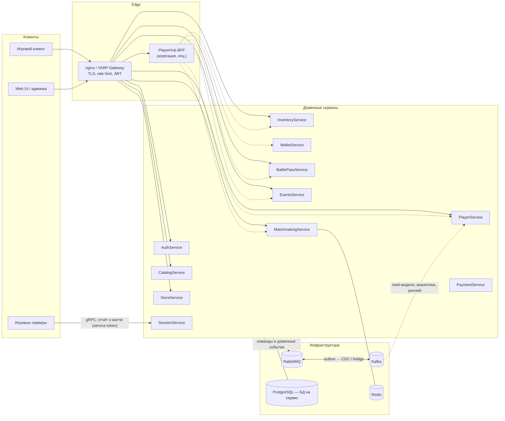
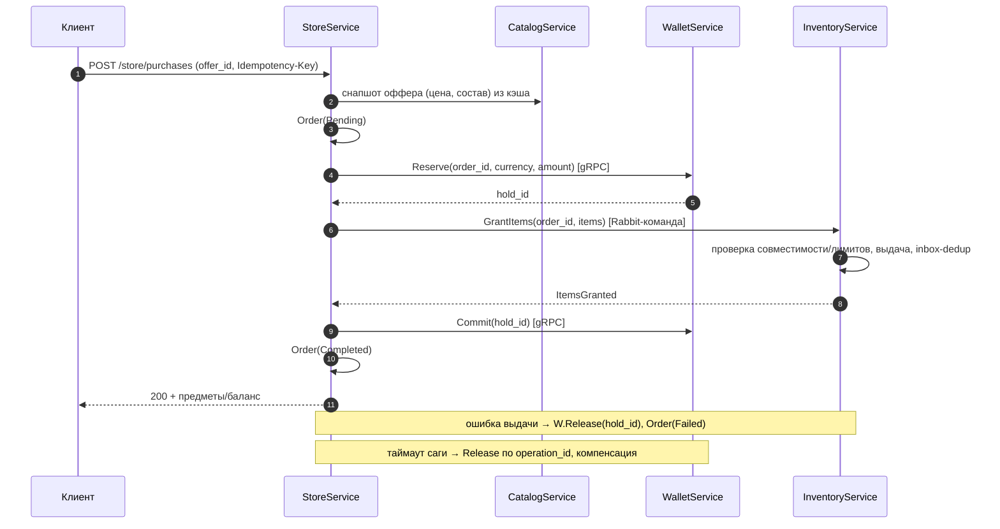
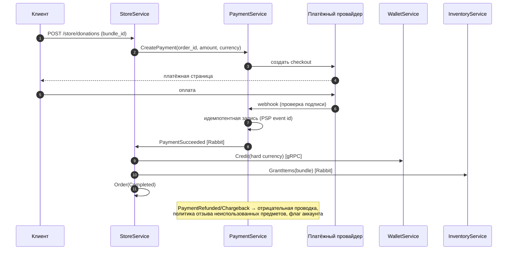
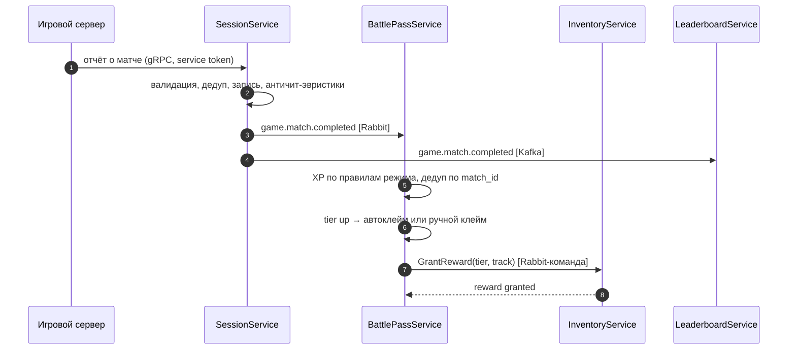
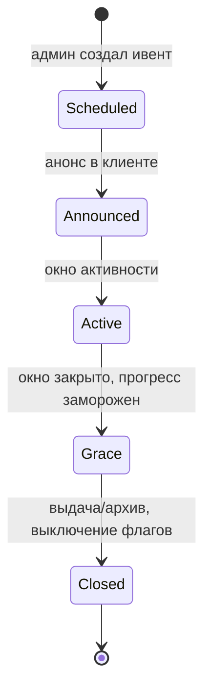
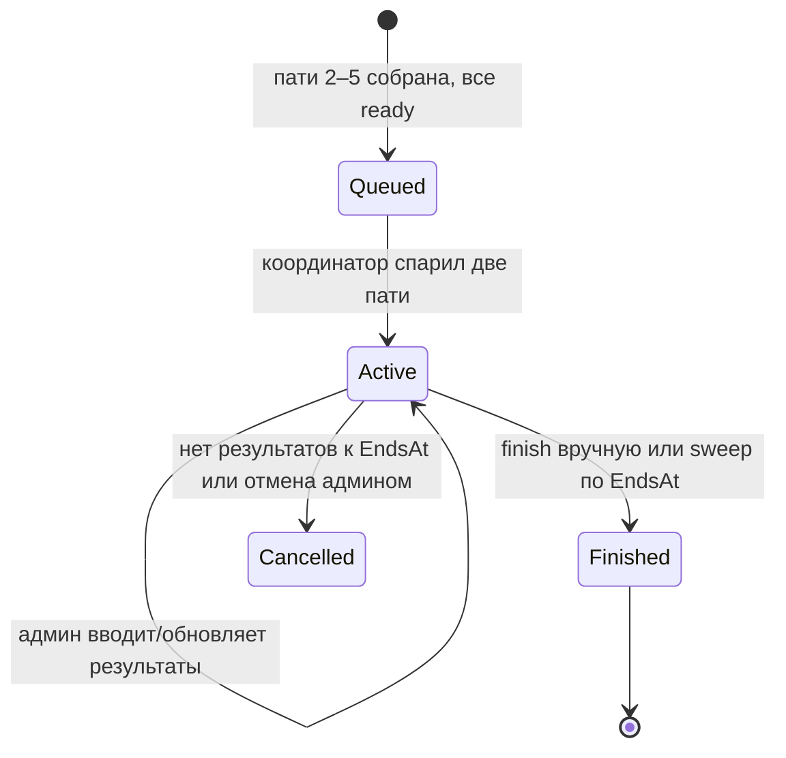
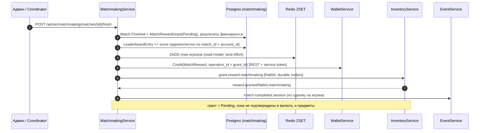

# GameServer-v2 — архитектура

> Статус: черновик плана. Масштаб: 50k+ одновременных игроков.
> Стек: .NET 10, PostgreSQL, RabbitMQ + Kafka, Redis, nginx → YARP.
> Базис: AuthService уже реализован (OIDC + Identity), остальные сервисы строятся
> по его слоям: `Domain / Contracts / Core / Infrastructure.Postgres / Web`.
>
> Решение (2026-10-21): кланы и клан-войны исключены. Вместо них —
> `MatchmakingService`: пати 2–5, простая очередь, длительные матчи двух пати,
> награды за матч и глобальный лидерборд. Упоминания кланов ниже — исторический
> контекст раннего черновика.

## 1. Цели и принципы

Функциональные домены (из требований):

1. авторизация (есть);
2. профиль игрока;
3. battle pass (сезоны, уровни, награды, задания);
4. сезонные ивенты (летний, новогодний и т.п.);
5. матчмейкинг: сбор пати, подбор соперников, длительные матчи 2 пати,
   награды за матч и лидерборд;
6. инвентарь и кастомизация: одежда, оружие, машины, тюнинг машин деталями;
7. покупки за игровую валюту и за реальные деньги (донат).

Нефункциональные требования:

| Параметр | Цель |
| --- | --- |
| Одновременный онлайн | 50k+ CCU, пики x3 в дни контентных релизов |
| Сезонные финалы | «шторм» записи очков в последние часы сезона |
| p99 API | ≤ 300 ms для клиентских чтений, ≤ 1 s для записи |
| Доступность | 99.9%, деградация по сервисам, а не отказ платформы |
| Экономика | аудит каждой операции, нулевая потеря/дублирование валюты |
| События сезонов | выплаты идемпотентны и воспроизводимы из архива |

Принципы:

- **DDD-границы.** Сервис = bounded context, а не «слой» и не таблица.
  Отдельный сервис оправдан своим жизненным циклом данных, нагрузкой или
  командой; иначе это модуль внутри сервиса (см. §12).
- **Database per service.** Никаких общих таблиц, JOIN'ов и FK между
  сервисами. Ссылки на чужие id — без FK.
- **Async-first.** Межсервисные изменения выполняются событиями/командами;
  синхронные вызовы — только для чтений и «горячих» транзакционных шагов.
- **Идемпотентность везде.** Клиентские POST — `Idempotency-Key`, консьюмеры —
  dedup по `EventId` (inbox), операции кошелька — по `operation_id`.
- **Транзакционный outbox** в каждом сервисе: сначала пишем БД, потом
  публикуем, at-least-once + идемпотентные консьюмеры.
- **Деньги — только ledger.** Double-entry, целочисленные минорные единицы,
  append-only, баланс — материализация из проводок.

## 2. Карта сервисов

| # | Сервис | Зона ответственности | Владеет данными (БД/схема) | Фаза |
| --- | --- | --- | --- | --- |
| 1 | **AuthService** *(есть)* | Аккаунты, пароли, роли/permissions, OIDC, service-токены | `auth` | 0 |
| 2 | **PlayerService** | Профиль (ник, аватар, регион), уровень/XP, статистика, флаги (бан, право на лидерборд) | `players` | 1 |
| 3 | **CatalogService** | Контент: одежда, оружие, машины, детали, их характеристики, цены, совместимость деталей, окна доступности. Админ-версионирование | `catalog` + Redis-кэш | 1 |
| 4 | **InventoryService** | Владение: купленные предметы, надетый аутфит, арсенал, гараж, конфиги тюнинга машин | `inventory` | 1 |
| 5 | **WalletService** | Балансы (soft/hard/event-валюты), holds/reserves, double-entry ledger, история | `wallet` | 1 |
| 6 | **StoreService** | Витрина офферов/скидок, заказы, сага покупки, чеки. Оркестрация покупок за обе валюты | `store` | 1 |
| 7 | **PaymentService** | Реальные деньги: PSP-интеграция, checkout, вебхуки, возвраты/чарджбеки, идемпотентность | `payments` | 3 |
| 8 | **BattlePassService** | BP-сезоны, уровни/награды (free/premium), прогресс, задания (ежедневные/недельные/сезонные), клеймы | `battlepass` | 2 |
| 9 | **EventsService** | Сезонные ивенты: календарь и фазы, ивент-задания/очки, ивент-награды, feature flags для клиента | `events` | 2 |
| 10 | **MatchmakingService** | Пати 2–5 игроков, простая FIFO-очередь, длительные матчи двух пати (дни), результаты, награды за матч, глобальный лидерборд | `matchmaking` + Redis ZSET | 2 |
| 11 | **SessionService** | Приём результатов матчей от игровых серверов: валидация, дедуп, античит-эвристики, канонический `MatchCompleted` | `sessions` | 3 |
| 12 | **PlayerHub BFF** *(опц.)* | Агрегация экрана входа: профиль + кошелёк + BP + пати + активные ивенты одним вызовом, кэш в Redis | — | 3 |
| 13 | **Notification/Mail** *(опц.)* | Внутриигровая почта (выдача наград/компенсаций), push/e-mail, шаблоны, локализация | `notifications` | 3 |

Прагматика: на старте `Wallet`+`Store` можно запустить одним сервисом
`CommerceService` и разделить по мере роста нагрузки/команды. `BattlePass` и
`Events` могут делить общий движок сезонов, но модели у них разные — это осознанная
развилка.

### Почему именно такие границы

- `MatchmakingService` держит пати, очередь и длительные матчи в одном bounded
  context: у них общий жизненный цикл (пати → очередь → матч → результат →
  награда). Лидерборд — read-model внутри него: истина в PostgreSQL (очки и
  результаты), Redis ZSET только ускоряет топ и «моё место» и пересобирается.
- `WalletService` отделён от `StoreService`: ledger — критичный инвариант
  (идемпотентность, аудит), витрина и саги меняются часто.
- `SessionService` — единственная точка контакта игровых серверов и ворота
  античита: всё остальное потребляет уже очищенный `MatchCompleted`. Пока
  результаты матчей вводит админ (`/admin/matchmaking/*`), контракт события
  `match-completed.session` уже совместим с будущим SessionService.
- Выдача наград матча идёт через существующие Wallet (REST + service-токен) и
  Inventory (RabbitMQ-команда), идемпотентно по id гранта, без отдельного
  «сервиса наград».

## 3. Схема связей



## 4. Коммуникации

### 4.1 Синхронные вызовы

| Вызов | Протокол | Зачем |
| --- | --- | --- |
| Клиент → Gateway → сервисы | HTTPS/REST | клиентские API |
| Игровой сервер → SessionService | gRPC (stream) + service token | отчёты о матчах, высокий RPS |
| Store → Wallet | gRPC | Reserve / Commit / Release — критичный путь покупки |
| Store → Catalog | REST (кэш Redis) | снапшот цены и состава оффера |
| BFF → сервисы | REST/gRPC параллельно | агрегация экрана входа |
| Matchmaking → Wallet | REST + service token | начисление валютной награды за матч |

Правила синхронного вызова: таймаут 1–2 s; retry только для идемпотентных
операций (GET, Reserve/Commit по operation_id); circuit breaker и bulkhead на
каждую зависимость (Polly / `Microsoft.Extensions.Http.Resilience`).

### 4.2 Асинхронные шины — разделение ролей

| Шина | Роль | Что идёт |
| --- | --- | --- |
| **RabbitMQ (MassTransit)** | Управление и координация | команды между сервисами, доменные события-триггеры, саги (state machine), retry/DLQ |
| **Kafka** | Журнал событий | `MatchCompleted` (высокий RPS), обновления standings, read-модели, аналитика, реплей, аудит |

Мост из RabbitMQ в Kafka не «двойная публикация», а **outbox + CDC**: сервис
пишет outbox-таблицу в своей БД; MassTransit EF-outbox публикует в RabbitMQ,
Debezium читает WAL и льёт те же события в Kafka-топики. Консьюмеры
идемпотентны по `EventId`, поэтому at-least-once на обеих шинах безопасен.

Kafka-топики ключуются по `player_id` / `match_id` — порядок событий по
«сущности» гарантирован. Имена версионируются: `game.match.completed.v1`.
На MVP можно начать только с RabbitMQ и включить Kafka-поток на фазе 2, не меняя
контракты событий.

### 4.3 Конверт события

```json
{
  "event_id": "uuid",
  "event_type": "game.match.completed",
  "event_version": 1,
  "occurred_at": "2026-10-03T12:00:00Z",
  "producer": "SessionService",
  "correlation_id": "trace-id",
  "causation_id": "event-id-предка",
  "payload": { }
}
```

### 4.4 Каталог событий (основные)

| Событие | Продюсер | Шина | Консьюмеры |
| --- | --- | --- | --- |
| `identity.account.registered` | Auth | Rabbit | Player (провижининг профиля) |
| `identity.account.blocked` | Auth | Rabbit | Player, Matchmaking (исключение из очереди) |
| `match-completed.session` | Matchmaking (позже Session) | Rabbit + Kafka | Player, BattlePass, Events, аналитика |
| `grant-reward.matchmaking` | Matchmaking | Rabbit | Inventory (выдача предметов) |
| `reward-granted/failed.matchmaking` | Inventory | Rabbit | Matchmaking (статус гранта) |
| `economy.purchase.completed` | Store | Rabbit | Inventory, BattlePass, Events, аналитика |
| `economy.wallet.credited/debited` | Wallet | Kafka | аналитика, антифрод |
| `payment.succeeded/failed/refunded` | Payment | Rabbit | Store, Wallet, аналитика |
| `inventory.items.granted` | Inventory | Kafka | аналитика, PlayerHub-кэш |
| `battlepass.tier.reached` | BattlePass | Rabbit | Inventory/Wallet (выдача), Gateway (пуш) |
| `liveops.event.started/ended` | Events | Rabbit | Gateway (флаги), Store, аналитика |

### 4.5 Переход на gRPC (план)

Принцип: **gRPC — только для внутренних service-to-service вызовов**; REST/JSON
остаётся для клиента, админки и внешних интеграций. Оба транспорта — тонкие
адаптеры над одними и теми же handler'ами (`Core`), логика, валидация и
идемпотентность не дублируются. Доменные `Error` конвертируются единым маппером
(HTTP-статус для REST / gRPC-статус для gRPC).

| Вызов | Сейчас | Целевой транспорт | Фаза |
| --- | --- | --- | --- |
| Store → Wallet `Reserve` / `Commit` / `Release` | REST, service-token | gRPC unary | 1 (Commerce) |
| Игровой сервер → SessionService (отчёты о матчах) | — | gRPC (server/bidi streaming) | 2 |
| BFF → сервисы (агрегация экрана входа) | — | gRPC unary (параллельно) | 3 |

Правила внедрения:

- контракт — отдельный проект/пакет (`.proto`), версионируется; номера полей не
  переиспользуются, старые методы не ломаются;
- аутентификация — тот же service-токен (`client_credentials`, scope на
  операцию) в gRPC-**metadata** (`authorization: Bearer …`);
- deadlines/таймауты 1–2 s; retry только для идемпотентных операций
  (`Reserve`/`Commit`/`Release` по `operation_id`); circuit breaker на каждую
  зависимость;
- gRPC **не выставляется в интернет** — только внутри compose/service mesh;
  наружу — REST, BFF или grpc-web; отдельный ingress-путь через nginx не
  создаётся;
- добавляется параллельно REST: существующие REST-эндпоинты не удаляются.

### 4.6 Realtime-оповещения клиентов (SignalR) — будущее

Решение: доставка серверных событий клиенту (старт/конец сезона, изменение
очков клана, личные награды/сообщения) — через **SignalR** (WebSocket с
автоматическим откатом на SSE / long polling). Транспорт выбран «на вырост»:
единый канал для браузера и Unity-клиента, с возможностью добавить
двусторонность (чат, если появится).

Поток:

```
бизнес-сервисы ── domain event ──► RabbitMQ/Kafka
                                        │
                                        ▼
                        RealtimeGateway (SignalR Hub)
                                        │  Redis backplane
                                        ▼
                        соединения клиентов
```

- Бизнес-сервисы **не держат клиентские соединения** — они публикуют события,
  рассылкой занимается отдельный **RealtimeGateway** (кандидат — расширение
  `Notification/Mail`).
- **Группы/каналы**: `player:{id}`, `match:{id}`, `liveops` (и `chat:{room}` —
  если появится ChatService). Подписка авторизуется по OIDC-токену и правам на
  группу.
- **Масштабирование**: несколько инстансов gateway, событие раздаётся всем через
  **Redis backplane** (Redis уже в compose). Порядок по сущности — ключ
  Kafka/Rabbit по `player_id`/`match_id`; дедуп на клиенте по `event_id`;
  высокочастотные события (счёт матча) — coalesce/throttle.
- **Клиент**: паттерн «REST-снимок + подписка на дельты» — сначала `GET`
  текущего состояния, затем `subscribe` на группу (иначе события между
  загрузкой и подпиской теряются).
- **Инфраструктура**: nginx `location` для hub с заголовками `Upgrade`/
  `Connection`; для SSE-fallback отключить буферизацию. Токен — через SignalR
  `accessTokenFactory` (короткоживущий тикет), не в query-строке.

## 5. Данные

### 5.1 Владение

| Сервис | Ключевые сущности |
| --- | --- |
| Auth | Account, Credential, Role, Permission, Client, Token |
| Player | Player, PlayerStats, NicknameHistory, FeatureFlags |
| Catalog | Item, ItemStats, CompatRule, Price, AvailabilityWindow, CatalogVersion |
| Inventory | OwnedItem, Outfit, Loadout, Car, CarInstallation, GrantReceipt (inbox) |
| Wallet | Wallet, Balance, LedgerEntry, Hold, Operation |
| Store | Offer, Order, OrderItem, PurchaseSaga, Receipt |
| Payment | PaymentOrder, PspTransaction, WebhookEvent, Refund, Chargeback |
| BattlePass | BpSeason, BpTier, BpProgress, BpMission, BpMissionProgress, BpClaim |
| Events | Event, EventPhase, EventQuest, EventProgress, EventRewardGrant |
| Matchmaking | Party, PartyMember, QueueTicket, Match, MatchParty, MatchParticipant, MatchResult, MatchRewardDefinition, MatchRewardGrant, LeaderboardEntry |
| Session | GameSession, SessionParticipant, RawReport, Dedup |

### 5.2 Консистентность и саги

- Локальные транзакции + outbox в одной БД-транзакции.
- Кросс-сервисные транзакции — только через саги с компенсациями
  (MassTransit state machine). Таймауты саг: hold живёт ≤ 5 минут.
- `player_id = account_id` (claim `sub`) — единая идентичность во всех сервисах,
  без маппинг-сервиса.
- Реферальные/статистические данные не шарятся, а проецируются событиями.
- Reconciliation-джобы: «orders ↔ wallet ledger», «grants ↔ purchases»,
  «match rewards ↔ wallet ledger / inventory receipts» — ежедневно.
- Планирование событий: Quartz с persistent store в PostgreSQL (`QRTZ_*` в
  `public`, `quartz.jobStore.clustered` включается опцией) хранит триггеры на
  `AnnounceAt`/`StartsAt`/`EndsAt`/`GraceEndsAt`; пропущенные границы
  догоняются по `misfire = FireNow`, при старте расписание пересобирается из БД.
  Дневной cron чистит устаревшие daily/weekly-прогрессы. Это не заменяет
  доменные таймеры матчей (Wolverine/coordinator), а покрывает календарь и ops.

### 5.3 Кэш и масштабирование данных

- Redis: сессии/лимиты, Catalog snapshot, лидерборды ZSET, BFF-кэш.
- PostgreSQL: одна managed-инсталляция с логической БД на сервис на старте;
  при росте — физическое разделение, затем шардирование по `player_id`.
- Чтения — из реплик; запись — только в primary своего сервиса.
- Catalog отдаётся клиенту через CDN/ETag, версии неизменяемы.

## 6. Ключевые сценарии

### 6.1 Покупка за игровую валюту (оружие, машина, деталь, одежда)



Для машины «покупка» создаёт `Car`, детали покупаются отдельными офферами и
ставятся через Inventory (проверка совместимости по Catalog).

### 6.2 Донат (реальные деньги)



### 6.3 Прогресс Battle Pass от матча



Premium-трек активируется покупкой (`PurchaseCompleted`) в том же сезонном окне.

### 6.4 Жизненный цикл сезонного ивента



Правила: ивент-очки начисляются только в окне `Active` (дедуп по `match_id`);
смена валюты/множителей — через версию конфигурации, а не правку активного
ивента; закрытие идемпотентно (batch id на ивент).

### 6.5 Длительный матч и лидерборд



Завершение матча и выдача наград:



Правила: результаты матча кумулятивны и обновляются админом, финализация
выполняется один раз (статус матча — гард); лидерборд считается по `score`
в PostgreSQL, Redis ZSET — ускоряющая проекция с пересборкой из PG; награды
идемпотентны по `grant_id` (валюта — `operation_id`, предметы — inbox Inventory),
неудачная выдача ретраится фоновым sweep'ом. Параметры (в конфиге
`Matchmaking`): размер пати 2–5, длительность матча, режимы, размер/бонус
награды, интервал подбора и пересборки лидерборда.

## 7. Доменные модели (кратко)

### 7.1 Инвентарь и кастомизация

- `OwnedItem(owner_id, item_id, kind, source, acquired_at)` — источник:
  `purchase | bp_reward | event_reward | match_reward | admin`.
- `Outfit(owner_id, slot, item_id)` — слоты одежды (голова/торс/ноги/обувь/
  аксессуары); экипировка — идемпотентная замена слота.
- `Weapon(owner_id, item_id, skin_id?)`, `Loadout(owner_id, slot, weapon_id)`.
- `Car(owner_id, car_item_id, color, plate, mileage?)`.
- `CarInstallation(car_id, slot, part_item_id)` — слоты тюнинга (двигатель,
  турбина, подвеска, тормоза, шины, нитро, кузов). Перформанс машины —
  вычисляемая проекция из базы + установленных деталей (кэшируется).
- Совместимость деталей — правило каталога (`CompatRule`); Inventory проверяет
  её по снапшоту каталога, Catalog остаётся источником истины.

### 7.2 Battle Pass

`BpSeason(starts_at, ends_at, max_tier, premium_price)` → `BpTier(tier,
xp_required, free_rewards[], premium_rewards[])`; `BpProgress(player, season)`;
`BpMission(kind: daily|weekly|season, xp, conditions)`; `BpClaim(tier, track)`.
XP-правила — конфиг сезона (режим, место, киллы, задания). Клеймы
идемпотентны; неполученные награды закрытого сезона — политика «сгорают» или
авто-выдача через Mail (продуктовое решение, по умолчанию авто-выдача).

### 7.3 События

`Event(code, kind, phases[], currency_code, content_version)` →
`EventPhase(announce|active|grace)`; `EventQuest` + `EventProgress(player)`;
`EventRewardGrant`. Ивент-валюта — отдельный код валюты в Wallet ledger, не
отдельный сервис. Магазин ивента — офферы Store с окном доступности.

### 7.4 Пати и очередь

`Party(code, leader_account_id, status: forming|queued|in_match|closed)` +
`PartyMember(account_id, is_ready, joined_at)` — 2–5 игроков, вход по инвайт-коду,
лидер ставит пати в очередь только когда все ready. `QueueTicket(party_id, mode,
party_size, status, enqueued_at, match_id)` — FIFO; координатор спаривает две
пати одного размера и режима.

### 7.5 Матчи, награды и лидерборд

`Match(mode, status: active|finished|cancelled, starts_at, ends_at, winner_party_id)`;
`MatchParty(match_id, party_id, side)`; `MatchParticipant(match_id, account_id,
party_id)` (уникально по `match_id + account_id`); `MatchResult(match_id,
account_id, score, kills, is_win)` — кумулятивно, обновляется админом;
`MatchRewardDefinition` (валюта, участие/бонус за победу, предметы) и
`MatchRewardGrant` (по игроку, статус Pending/Granted/Failed, `wallet_operation_id`,
флаги выдачи валюты/предметов); `LeaderboardEntry(account_id, points, wins,
matches_played)` — истина, Redis ZSET `matchmaking:leaderboard:global` — проекция.

Анти-абьюз: результаты принимаются только для участников матча, дедуп по
`match_id + account_id`, финализация один раз, награды идемпотентны по `grant_id`.

## 8. Безопасность и авторизация

| Актёр | Токен | Права |
| --- | --- | --- |
| Игрок | OIDC user token (Authorization Code + PKCE) | свои данные: профиль, инвентарь, покупки, клеймы |
| Игровой сервер | client_credentials, scope `session.write` | только отчёты о матчах |
| Сервис | client_credentials, scope на операцию (`wallet.write`, `inventory.write`, `catalog.read`, `matchmaking.manage`, …) | внутренние вызовы |
| Модератор/админ | user token + permissions | `users.manage`, `catalog.manage`, `liveops.manage`, `matchmaking.manage`, `economy.audit` |

- Gateway валидирует JWT, лимитирует по IP/аккаунту, отсекает всё кроме
  известных префиксов; внутри — mTLS (service mesh) или подписанные токены.
- PSP-вебхуки: проверка подписи, идемпотентность по событию провайдера, отдельный
  ingress-путь без пользовательской авторизации.
- Аудит админских и экономических операций — обязательный, в отдельную таблицу
  с актором и корреляцией.

## 9. Отказоустойчивость

- Retry с экспоненциальным backoff и jitter; только идемпотентные операции.
- Circuit breaker: Store→Wallet, Inventory→Catalog, BFF→все; bulkhead на
  каждую зависимость.
- MassTransit: retry-политики, `_error`-очереди, инструмент повторной обработки,
  saga timeouts.
- Kafka: at-least-once, консьюмер-группы, DLQ-топики; реплей для ребилда
  read-моделей.
- Деградация: если Wallet недоступен — покупки ставятся в очередь с
  предварительной проверкой по кэшу; чтения профиля/каталога продолжают работать.
- Плановые maintenance-окна для сезонных выплат исключены: выплата — фоновая
  операция с идемпотентными батчами и чекпойнтами.

## 10. Наблюдаемость

- OpenTelemetry: trace через HTTP/gRPC/RabbitMQ/Kafka (`traceparent` в конверте
  события), экспорт в Tempo/Jaeger.
- Логи: Serilog → Loki, correlation/causation id в каждой записи.
- Метрики (Prometheus/Grafana): бизнес — покупки/мин, конверсия доната, лаг
  ingest матчей, длина очередей, успех выплат; технические — p50/p95/p99,
  ошибки по зависимостям, DLQ depth.
- Алерты: DLQ > 0 в критичных очередях, провал сезонного scheduler'а, всплеск
  webhook-ошибок PSP, расхождение reconciliation-джоб.

## 11. Деплой и масштабирование

- Dev: docker-compose (Postgres, RabbitMQ, Redis; Kafka — опционально).
- Prod (50k+): Kubernetes, HPA по CPU/RPS и длине очередей, PodDisruptionBudget,
  managed PostgreSQL (реплики для чтения), Kafka 3+ брокера, RabbitMQ quorum
  queues, Redis cluster/sentinel, CDN для каталога, S3 для снапшотов.
- Выкат: blue-green/canary, миграции EF отдельным контейнером (как сейчас),
  обратно-совместимые контракты событий (версия в топике/типе).
- Gateway: nginx остаётся на входе; при росте — YARP-шлюз с валидацией JWT,
  rate limit и BFF-маршрутизацией, чтобы не разрастался nginx.conf.

## 12. Этапы внедрения

| Фаза | Что делаем | Критерий готовности |
| --- | --- | --- |
| 0. Фундамент | Shared.Messaging (outbox/inbox, MassTransit), конверт событий, шаблон сервиса, Redis/RabbitMQ в compose, observability | новый сервис поднимается из шаблона, событие доходит end-to-end |
| 1. Игрок и экономика | Player, Catalog, Inventory, Wallet, Store (игровая валюта), Session-контракт (заглушка отчётов) | покупка одежды/оружия/машины/детали, гараж и тюнинг, профиль |
| 1.5 gRPC-транспорт | `.proto`-контракт Wallet `Reserve/Commit/Release`, gRPC-сервер рядом с REST, gRPC-клиент в Store; общий маппер ошибок | Store вызывает Wallet по gRPC, REST-эндпоинты кошелька продолжают работать |
| 2. Сезонный контент | BattlePass, Events (Quartz-планировщик фаз), **Matchmaking (реализовано)**, реальные отчёты матчей | BP-сезон, летний/новогодний ивент, пати/очередь/длительные матчи, награды и лидерборд |
| 3. Донат и сервис-полировка | Payment, hard-валюта, premium BP, Notification/Mail, BFF, аналитика | донат end-to-end, возвраты, почта, агрегированный экран входа |
| 3.5 Realtime-оповещения | SignalR-hub (RealtimeGateway), Redis backplane, группы `player/match/liveops`, консьюмеры событий, «снимок + подписка» на клиенте, nginx WebSocket | клиент получает старт сезона, статус матча и личные события в реальном времени |
| 4. Масштаб | реплики/шардирование PG, Kafka-реплей, canary, anti-fraud ML-сигналы | нагрузочный тест 50k+ CCU, сезонный «шторм» выдерживается |

## 13. Открытые вопросы

1. **Игровые серверы**: какой движок/протокол, сервер-авторитативность, как
   передаются отчёты (gRPC-стрим или батчи)? От этого зависит SessionService.
2. **Мир один или регионы**: шардирование по `player_id`, региональные
   очереди матчмейкинга (отдельный координатор на регион?).
3. **Продуктовые параметры матчмейкинга**: размер пати (сейчас 2–5), пара пати
   одного размера, длительность матча (сейчас 48 ч), формула очков лидерборда,
   сгорают ли награды при отмене матча.
4. **Ники**: уникальность и правила смены (Player), фильтр мата, резервация.
5. **Чат/друзья/приглашения**: пати уже есть; нужен ли отдельный ChatService
   (WebSocket) в фазе 2–3.
6. **Торговля между игроками/аукцион**: нет в плане; сильно влияет на экономику
   и антифрод.
7. **PSP**: выбор провайдера (Stripe/Xsolla/Steam), регионы, налоги, возвраты.
8. **Premium BP**: политика при покупке в середине сезона (ретро-выдача наград).
9. **Тюнинг**: влияет ли на геймплей (баланс, античит) или только косметика.
10. **Лимиты**: количество машин/скинов на игрока, размер гаража, лимиты инвентаря.
