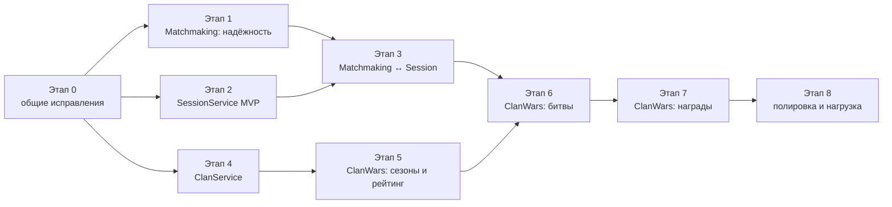

# План реализации: SessionService, MatchmakingService, кланы

> Статус: этапы 0–4 реализованы на ветке `feature/sessions-and-matchmaking-reliability`
> (интеграционные тесты на Testcontainers не написаны), этапы 5–8 не начаты. Дата: 2026-10-25.
> Связанные документы: `docs/architecture.md`, схема кланов —
> https://claude.ai/artifact/6CeKfSXPU2dT2qLShGztou
>
> Решение 2026-10-21 исключало кланы из architecture.md. Этот план возвращает их
> отдельным доменом (ClanService + ClanWarsService) поверх матчмейкинга и сессий.

Статусы: `[ ]` не начато · `[~]` в работе · `[x]` готово

---

## 1. Цель и границы

- **SessionService** — единственная точка контакта с игровыми серверами: реестр
  живых сессий, выдача join-тикетов, приём heartbeat и отчётов о матчах,
  публикация канонического `match-completed.session`.
- **MatchmakingService** — уже есть: пати, очередь, матчи, результаты, награды,
  лидерборд. Нужно: исправить найденные проблемы и перевести приём результатов
  с ручного ввода админом на отчёты от SessionService. Добавить «внешние» матчи
  для клановых битв.
- **ClanService** — кланы, состав, роли, заявки, клановые поинты.
- **ClanWarsService** — сезоны по расписанию, клановые битвы, очки, лидерборд,
  закрытие сезона и награды.

Вне границ: сам игровой сервер (Unity) и система выделения серверов (Fleet API).
Для них в dev делаем заглушки.

## 2. Порядок и зависимости

Параллельно можно вести: этапы 1 и 2 (разные сервисы), этап 4 сразу после
этапа 0. Этап 6 — точка сборки: ему нужны и Session, и Matchmaking, и сезоны.

Оценка размера: S — до 3 дней, M — до недели, L — 1–2 недели на одного разработчика.

| Этап | Размер | Результат |
| --- | --- | --- |
| 0. Общие исправления | M | Шаблоны, которые повторно используют все новые сервисы |
| 1. Matchmaking: надёжность | M | Матчмейкинг безопасен на двух репликах |
| 2. SessionService MVP | L | Игровой сервер (заглушка) подключается, игроки входят по тикету, отчёты принимаются |
| 3. Matchmaking ↔ Session | M | Результаты матчей приходят от серверов, а не от админа |
| 4. ClanService | M | Кланы, состав, роли, push клану |
| 5. ClanWars: сезоны и рейтинг | M | Сезоны стартуют и закрываются по расписанию, рейтинг виден |
| 6. ClanWars: битвы | L | Кланы сражаются, очки начисляются автоматически |
| 7. ClanWars: награды | M | Награды за сезон выдаются без ручной работы |
| 8. Полировка | M | Антиабьюз, нагрузочный тест, плейтест |

---

## Этап 0. Общие исправления (Shared и шаблон сервиса)

Цель: не тащить известные ошибки в три новых сервиса.

- [x] Health checks: `/health/live` без зависимостей и `/health/ready` с
  PostgreSQL и RabbitMQ — в общем пакете `Shared.Framework`
- [x] Порядок middleware в шаблоне: обработка исключений → correlation id →
  логирование запроса → routing → CORS → auth
- [x] Options через `AddOptions<T>().BindConfiguration().ValidateDataAnnotations().ValidateOnStart()`
- [x] `ServiceTokenProvider`: токен и срок в одном неизменяемом объекте,
  `volatile`-ссылка; сброс кэша и один повтор при 401
- [x] Регистрация `IReadDbContext` через тот же контекст из пула:
  `AddScoped<IReadDbContext>(sp => sp.GetRequiredService<TContext>())`
- [x] Обработчики сообщений: проверять результат `SaveChangesAsync` и бросать
  исключение при ошибке (Store, Inventory — образец для новых)
- [x] Разделение ошибок в обработчиках: бизнес-отказ → событие `*-failed`,
  техническая ошибка → исключение и ретраи
- [x] `TimeProvider` в DI вместо `DateTime.UtcNow` в домене новых сервисов
- [x] Хелпер для ловли `23505` (нарушение уникальности) → «операция уже была»
- [x] Хелпер для раздачи работы через `FOR UPDATE SKIP LOCKED`

Готово, когда: шаблон нового сервиса содержит всё перечисленное, Store и
Inventory переведены на исправленные обработчики.

> Сделано: health checks, `ServiceTokenProvider`, хелперы 23505 / `SKIP LOCKED` /
> обработки ошибок — в пакетах `Owlip.Shared.*` 0.2.0 (репозиторий Shared, **не опубликованы**);
> `ServiceTokenProvider` из `backend/Shared/Communication` исправлен так же. Порядок
> middleware, health checks и `IReadDbContext` исправлены во всех сервисах. Образец
> нового сервиса — SessionService.

---

## Этап 1. MatchmakingService: надёжность

Цель: матчмейкинг корректно работает на двух и более репликах.

- [x] `MatchmakingCoordinator`: выборка тикетов через `FOR UPDATE SKIP LOCKED`
  в транзакции; закрытие просроченных матчей и ретрай наград — так же
- [x] `LeaderboardEntry`: начисление очков атомарным UPDATE
  (`points = points + @delta`) или `xmin` как concurrency token
- [x] Redis-лидерборд:
  - [x] составной score (очки + время достижения) для ничьих
  - [x] `ZADD` абсолютного значения из PostgreSQL вместо `ZINCRBY`
  - [x] пересборка во временный ключ пачками + `RENAME`, под
    `pg_try_advisory_lock`, только при расхождении, а не по таймеру
  - [x] фолбэк чтения топа из PostgreSQL, если Redis недоступен
- [x] Redis убрать из readiness Matchmaking (некритичная зависимость)
- [x] Wallet: перейти с REST на общий gRPC-клиент (`WalletService.Contracts`)
- [x] `IOptionsMonitor` для параметров подбора, которые меняет геймдизайн
- [ ] Рейтинг для PvP-режимов (Elo/Glicko) и окно допуска, расширяющееся со
  временем ожидания — задел, можно отложить до этапа 8
- [ ] Интеграционные тесты: два экземпляра координатора на одной базе не
  создают двойных матчей; повтор финализации не задваивает очки

Готово, когда: нагрузочный сценарий «200 пати в очереди, 2 реплики» не даёт
дублей матчей и расхождения лидерборда с PostgreSQL.

> Не проверено: интеграционные тесты и нагрузочный сценарий не написаны (Docker для
> Testcontainers был недоступен). Unit-тесты — составной score лидерборда.

---

## Этап 2. SessionService MVP

Цель: игровой сервер (пока заглушка) регистрируется, игроки попадают на него по
join-тикету, сервер отчитывается о матчах.

### Домен и данные (схема `sessions`)

- [x] `GameServer`: id, адрес, регион, режимы, ёмкость, статус, last_heartbeat_at
- [x] `Session`: id, server_id, kind (`free-roam` / `match`), mode, region,
  max_players, status (`Allocating → Active → Ending → Closed`), match_id (для матчей)
- [x] `SessionPlayer`: session_id, account_id, joined_at, left_at
- [x] `RawReport`: id, session_id, server_id, activity_id (уникальный), payload jsonb,
  received_at — сырые отчёты для разбора споров и античита
- [x] Redis: `session:{id}` (живой реестр, TTL продлевается heartbeat),
  `presence:server:{id}`

### API

- [x] REST для клиента (через Gateway, JWT игрока):
  - `POST /sessions/join` — войти в открытый мир (регион, режим)
  - `POST /sessions/join-friend/{accountId}` — к другу (проверка блок-листа позже, с Social)
  - ответ: адрес сервера + join-тикет
- [x] gRPC для игровых серверов (service-токен, scope `session.write`):
  - `Register` / `Heartbeat` (client streaming) — регистрация и продление
  - `ValidateJoinTicket` — проверка тикета игрока при подключении
  - `PlayerJoined` / `PlayerLeft`
  - `ReportMatch` — итог матча: участники, счёт, победитель, статистика
- [x] Join-тикет: короткий JWT (60 с) с `sub`, `session_id`, подпись ключом
  SessionService из Lockbox; публичный ключ отдаётся серверам

### Логика

- [x] Подбор сессии для входа: друг → полупустая сессия региона → новый сервер
- [x] `IGameServerAllocator`: интерфейс к Fleet API; реализации
  `StaticPoolAllocator` (dev: список заранее запущенных серверов) и позже
  настоящий Fleet API
- [x] Закрытие «мёртвых» сессий: ключ в Redis истёк → `Active → Closed`,
  игроки отмечаются вышедшими (фоновая задача через `SKIP LOCKED`)
- [x] Приём отчёта: проверка, что сервер владеет сессией и игроки были в ней;
  дедуп по `activity_id`; запись `RawReport` и публикация события в одной
  транзакции (outbox)
- [x] Минимальные античит-проверки отчёта: длительность матча, лимиты очков и
  убийств за минуту; подозрительное → флаг в отчёте (позже — в Moderation)

### События (exchange `session-events`)

- [x] `match-completed.session` — **существующий контракт** `MatchCompletedEvent`
  (по одному на игрока); теперь его публикует Session. Добавить необязательные поля
  `SessionId`, `ExternalRef` без поломки старых потребителей
- [x] `player-joined.session` / `player-left.session` — для Social и presence
- [x] `session-closed.session`

### Инфраструктура

- [x] Проект по шаблону: Domain / Contracts / Core / Infrastructure.Postgres /
  Infrastructure.Redis / Web; Dockerfile со стадией `migrations`
- [x] docker-compose: `session-service`, `session-migrator`, БД `sessions`
- [x] nginx / Gateway: `/sessions/*` наружу; gRPC — только внутренний порт
- [x] AuthService: scope `session`, ресурс `session-service`, клиент
  `game-server` (client_credentials, scope `session.write`)
- [x] Консольная заглушка игрового сервера (`tools/FakeGameServer`):
  регистрируется, шлёт heartbeat, принимает «игроков» по тикетам, отправляет
  отчёт о матче — для локальной разработки и интеграционных тестов

Готово, когда: два «игрока» через REST получают тикет, заглушка сервера
принимает их, присылает `ReportMatch`, и в RabbitMQ появляется
`match-completed.session` ровно один раз даже при повторе отчёта.

> Сценарий собран (`backend/tools/FakeGameServer`, шаги в `backend/SessionService/README.md`),
> но end-to-end в Docker не прогонялся. Unit-тесты — домен сессии, проверки отчёта,
> join-тикеты. Ключ тикетов в dev эфемерный; в production — `JoinTickets__SigningKeyPem` из Lockbox.

---

## Этап 3. Matchmaking ↔ Session

Цель: матч из очереди проводится на игровом сервере, результат приходит от
сервера, награды и лидерборд работают как раньше.

- [x] Matchmaking после создания матча отправляет команду
  `allocate-match.matchmaking` (match_id, режим, регион, участники) в Session
- [x] Session выделяет сервер, создаёт `Session(kind = match)` и отвечает
  событием `match-allocated.session` (адрес сервера); Matchmaking сохраняет его
  в матч и пушит игрокам через Realtime
- [x] Игроки получают join-тикет через `GET /matchmaking/matches/me`
  (Matchmaking запрашивает тикет у Session по gRPC)
- [x] Matchmaking слушает `match-completed.session`: записывает результаты и
  запускает `MatchFinalizer` вместо ручного `SubmitResults` админом
- [x] `MatchFinalizer` больше **не публикует** `match-completed.session`
  (теперь это делает Session); EventService продолжает получать то же событие
- [x] Флаг `Matchmaking:ResultsSource = Admin | Session` на время перехода;
  админские эндпоинты остаются для спорных случаев
- [x] Обработка отказа: сервер не выделен за N секунд или упал → матч
  `Cancelled`, пати возвращаются в очередь с приоритетом
- [x] Контрактный тест: формат `MatchCompletedEvent` совместим со старым
  потребителем EventService

Готово, когда: матч от очереди до наград проходит без участия админа на
заглушке игрового сервера, EventService засчитывает прогресс заданий.

> Сделано: регион в очереди и матче; `allocate-match` / `match-allocated` / `match-allocation-failed`;
> тикет через gRPC `MatchSessions.IssueMatchTicket`; `match-ready.matchmaking` → Realtime;
> результаты из `match-completed.session` (с `ReportPlayerCount`, чтобы понять, что отчёт пришёл
> целиком); отмена и приоритетная переочередь при отказе, таймауте и падении сервера;
> `Matchmaking:ResultsSource` (по умолчанию `Admin`, в Docker — `Session`). Контрактный тест —
> `MatchCompletedContractTests`. End-to-end сценарий в Docker не прогонялся.

---

## Этап 4. ClanService

Цель: социальная часть кланов.

### Данные (схема `clans`)

- [x] `clans`: id, tag (уникальный), name, leader_account_id, member_count,
  clan_points, created_at, xmin
- [x] `clan_members`: clan_id, account_id (уникальный — один клан на игрока),
  role (`Leader` / `Officer` / `Member`), joined_at
- [x] `clan_join_requests`: заявки и приглашения со статусами
- [x] `clan_points_ledger`: clan_id, operation_id (уникальный), amount, reason
- [x] `clan_member_history`: для кулдауна на повторное вступление

### API

- [x] `POST /clans` (создание может стоить валюту: резерв и commit в Wallet)
- [x] `GET /clans/{id}`, `GET /clans/me`, поиск по тегу и имени
- [x] заявки и приглашения: создать, принять, отклонить
- [x] роли, исключение, выход, передача лидерства, роспуск
- [x] админ: `/admin/clans/*` (просмотр, корректировка поинтов с аудитом)

### Правила

- [x] Лимит участников — атомарный `UPDATE ... WHERE member_count < @max`
- [x] Один клан на игрока — уникальный индекс
- [x] Кулдаун на вступление после выхода (по умолчанию 24 ч)
- [x] Права действий по ролям проверяются в домене
- [x] Поинты меняются только через ledger, идемпотентно по `operation_id`

### События (exchange `clan-events`)

- [x] `clan-created.clan`, `clan-disbanded.clan`
- [x] `member-joined.clan`, `member-left.clan`, `member-role-changed.clan`
- [x] слушать `clan-points-granted.clanwars` → начисление поинтов

### Интеграции

- [x] Realtime: группа `clan:{id}` (при `Authenticate` по проекции состава или
  запросом в ClanService), события клана → push
- [x] AuthService: scope `clans` уже есть — проверить ресурс и клиент
  `ClanService`, permissions `clans.view` / `clans.manage`
- [x] docker-compose, migrator, nginx `/clans/*`, фронтенд: страница клана

Готово, когда: игроки создают кланы, вступают, меняют роли, участники клана
получают push о вступлении нового игрока.

> Сделано: `backend/ClanService` (см. README), группа `clan:{id}` в RealtimeService с
> проекцией состава в Redis, клиент `clan-service-client` со scope `wallet` (для комиссии
> за создание), страница `/clans` во фронтенде. Push видит Unity-клиент: во фронтенде нет
> realtime-подключения, страница обновляется запросами. Не проверено end-to-end в Docker.

---

## Этап 5. ClanWarsService: сезоны и рейтинг

Цель: сезоны по расписанию и лидерборд кланов, пока с ручным начислением очков.

- [ ] Проект по шаблону, схема `clanwars`
- [ ] `seasons`: number, starts_at, ends_at, status, scoring_rules (jsonb),
  reward_table_id; админ создаёт и публикует черновики
- [ ] Фазы `Scheduled → Active → Finalizing → Rewarding → Closed` вычисляются
  из расписания; Quartz (JobStore в PostgreSQL, clustered, `misfire = FireNow`)
  по образцу `EventScheduler` / `EventPhaseJob`
- [ ] Проекция состава `clan_roster` из событий ClanService (inbox, идемпотентно)
- [ ] `season_scores`: начисление атомарным UPDATE; `score_receipts` для
  идемпотентности по источнику очков
- [ ] Redis ZSET `clanwars:season:{id}`: составной score, `ZADD` абсолютного
  значения, пересборка через `RENAME` (сразу в исправленном виде из этапа 1)
- [ ] API: текущий сезон, топ-100, место своего клана с соседями, вклад участников
- [ ] Админ: ручная корректировка очков с аудитом (для тестов до этапа 6)
- [ ] События: `season-started.clanwars`, `season-ended.clanwars` → Realtime

Готово, когда: тестовый сезон длиной в час стартует и закрывается сам, в том
числе если сервис был выключен в момент границы фазы.

---

## Этап 6. ClanWarsService: битвы

Цель: клановые битвы через существующий контур матчей.

- [ ] `battle_windows`: окна битв в сезоне (генерация из шаблона «каждый день 19–23»)
- [ ] Очередь отрядов `battle_queue`: офицер ставит отряд; проверки — окно
  открыто, отряд в составе клана, клан не в битве
- [ ] Подборщик (`BackgroundService` + `PeriodicTimer` + `SKIP LOCKED`):
  близкий рейтинг, окно допуска растёт со временем, лимит повторов с одним
  соперником в день
- [ ] `battles`: SCHEDULED → IN_PROGRESS → FINISHED / CANCELLED, переходы
  условным UPDATE
- [ ] Matchmaking: «внешний» матч без пати — команда
  `create-external-match.matchmaking` (ExternalRef = battle_id, две команды
  игроков, режим `clan-battle`); результат — событие
  `external-match-completed.matchmaking` с тем же ExternalRef
- [ ] ClanWars слушает результат: переход битвы, очки по `scoring_rules`,
  `score_receipts` по battle_id, обновление ZSET, `member_season_stats`
- [ ] Финализация сезона учитывает битвы, начатые до `ends_at`
- [ ] Push: `battle-found`, `battle-finished` в группу `clan:{id}`

Готово, когда: две тестовые команды из двух кланов проходят битву на заглушке
сервера, очки начисляются один раз даже при повторной доставке результата.

---

## Этап 7. ClanWarsService: награды

- [ ] `reward_tables` / `reward_tiers`: диапазоны мест → поинты клану, валюта и
  предметы участникам, `min_battles`
- [ ] Закрытие сезона: условный переход `Active → Finalizing`, снимок
  `season_results`, создание `season_reward_grants` (клану и участникам с
  battles ≥ min) в одной транзакции
- [ ] Sweeper выдачи по образцу `MatchRewardDispatcher`: пачки, ограничение
  параллелизма; поинты — событие в ClanService, валюта — gRPC Credit в Wallet
  (`operationId = grant_id`), предметы — команда в Inventory
- [ ] Статусы грантов Pending → Granted / Failed, ретраи с backoff, алерт на Failed
- [ ] Переход `Rewarding → Closed`, когда все гранты выданы
- [ ] Ежедневная сверка: гранты ↔ ledger Wallet ↔ ledger поинтов ↔ inbox Inventory

Готово, когда: сезон на 1 000 тестовых кланов закрывается, все 30 000 грантов
выданы, повторный запуск закрытия ничего не задваивает.

---

## Этап 8. Полировка и нагрузка

- [ ] Антиабьюз кланов: кулдауны, договорные битвы (меньше очков за победу над
  слабым), сигналы в будущий Moderation
- [ ] Лиги внутри сезона (если решит геймдизайн)
- [ ] Рейтинг PvP в Matchmaking (если отложили на этапе 1)
- [ ] Нагрузочные сценарии k6:
  - шторм входа в открытый мир (Session `join`)
  - конец окна битв (результаты 500 битв за минуту)
  - закрытие сезона
- [ ] Дашборды и алерты: длина очередей, DLQ, Failed-гранты, lag проекции
  состава, расхождение ZSET и PostgreSQL
- [ ] Документация: обновить `docs/architecture.md` (вернуть кланы, описать
  Session как реализованный)

---

## 3. Сводка контрактов

| Событие / команда | Источник | Получатели | Этап |
| --- | --- | --- | --- |
| `match-completed.session` (существующий) | Session (было: Matchmaking) | Matchmaking, Event, Profile | 2–3 |
| `player-joined/left.session` | Session | Social (позже), Realtime | 2 |
| `allocate-match.matchmaking` (команда) | Matchmaking | Session | 3 |
| `match-allocated.session` | Session | Matchmaking | 3 |
| `clan-created/disbanded.clan` | Clan | ClanWars, Realtime | 4 |
| `member-joined/left/role-changed.clan` | Clan | ClanWars, Realtime | 4 |
| `season-started/ended.clanwars` | ClanWars | Realtime, Store, аналитика | 5 |
| `create-external-match.matchmaking` (команда) | ClanWars | Matchmaking | 6 |
| `external-match-completed.matchmaking` | Matchmaking | ClanWars | 6 |
| `battle-finished.clanwars` | ClanWars | Realtime, аналитика | 6 |
| `clan-points-granted.clanwars` | ClanWars | Clan | 7 |
| `grant-items.clanwars` (команда) | ClanWars | Inventory | 7 |

Правила для всех: outbox на отправке, inbox на приёме, уникальный id операции в
каждой команде, только обратно совместимые изменения контрактов.

## 4. Общие критерии готовности для каждого этапа

- Unit-тесты домена и валидаторов, интеграционные тесты на Testcontainers
  (PostgreSQL, RabbitMQ, Redis) для каждого сценария «готово, когда»
- Тест повторной доставки каждого сообщения и повторного вызова каждой команды
- Миграции обратно совместимы (expand/contract)
- Сервис в docker-compose, маршрут в nginx / Gateway, scope и клиент в AuthService
- Health checks live/ready, structured logging с correlation id, метрики
- README сервиса: эндпоинты, события, конфигурация

## 5. Открытые вопросы

1. Формат клановой битвы: синхронный матч отрядов (как в плане) или асинхронная
   война с атаками на защиту клана. От ответа зависит этап 6.
2. Размер клана и отряда, число битв в день, окна битв по регионам.
3. Лиги в сезоне или один общий рейтинг.
4. На что тратятся клановые поинты (улучшения, магазин, косметика).
5. Награды участникам одинаковые или по вкладу.
6. Что с наградами при роспуске клана или выходе игрока в конце сезона.
7. Fleet API: кто и когда даёт настоящий интерфейс выделения игровых серверов.
8. Нужен ли мягкий перенос рейтинга клана между сезонами для подбора соперников.
